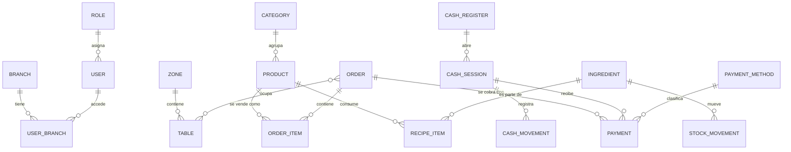

# Wito — Modelo de datos (v0.1)

Documento de diseño. Se guarda en `docs/modelo-de-datos.md` y se actualiza cada vez que cambie el esquema. Primero se cambia este documento y después el código.

Base: **SQLite** en el servidor del local (modo WAL). Acceso solo desde `packages/db`.

---

## 1. Convenciones (obligatorias en todas las tablas)

| Tema | Regla |
|---|---|
| **IDs** | `TEXT`, UUID v7 (ordenable por tiempo). Se generan en el cliente o en el servidor, nunca autoincrementales. |
| **Dinero** | `INTEGER` en centavos. Columnas terminadas en `_cents`. Prohibido usar decimales. |
| **Porcentajes** | `INTEGER` en puntos básicos (21 % = `2100`). Columnas terminadas en `_bp`. |
| **Fechas** | `INTEGER`, milisegundos Unix en UTC. Columnas terminadas en `_at`. Se muestran en la zona horaria del negocio. |
| **Booleanos** | `INTEGER` 0/1. |
| **Enums** | `TEXT` con `CHECK` que limita los valores permitidos. |
| **Columnas comunes** | `id`, `created_at`, `updated_at`, `deleted_at` (nulo si está activo). |
| **Sucursal** | Toda tabla operativa lleva `branch_id`. Prepara el multisucursal y la sincronización. |
| **Borrado** | Borrado lógico (`deleted_at`) en todo lo que tenga historial. **Nunca se borran ventas, pagos ni auditoría.** |
| **Snapshots** | Los ítems de un pedido guardan nombre, precio e impuesto del momento. Cambiar un producto no altera ventas pasadas. |
| **Auditoría** | Anular, descontar, reabrir, cambiar precios o permisos: siempre deja registro en `audit_log`. |
| **Cantidades de stock** | `INTEGER` en milésimas de la unidad base (1,5 kg = `1500` si la unidad base es el kilo). Evita errores de redondeo. |

> En la base local hay un solo negocio. El campo `business_id` existe en `branches` para cuando se sincronice con la nube multi-negocio.

---

## 2. Mapa general



---

## 3. Fases de implementación

| Fase | Grupos |
|---|---|
| **1 — MVP** | Estructura, Acceso, Catálogo, Salón, Ventas, Caja, Sistema (auditoría, backups, licencia, impresoras) |
| **2** | Clientes, Delivery, Combos y listas de precios |
| **3** | Stock, Compras, Gastos, Documentos fiscales |
| **4** | Fidelidad, Reservas, Sincronización con la nube |

El esquema de la Fase 1 ya deja los ganchos (por ejemplo `customer_id` en pedidos) para no migrar a lo loco después.

---

## 4. Estructura

### `branches`
Sucursales del negocio.
- `id`, `business_id`, `name`, `address`, `phone`
- `fiscal_pos_number` (punto de venta fiscal, para facturación)
- `timezone`, `currency`, `active`

### `business`
Una sola fila en la instalación local.
- `id`, `name`, `legal_name`, `tax_id`, `tax_condition`, `locale`, `currency`

### `settings`
Configuración clave-valor.
- `id`, `branch_id` (nulo = global), `key`, `value_json`
- Único: (`branch_id`, `key`)
- Ejemplos de claves: `stock.deduct_on`, `tips.enabled`, `orders.require_table`, `cash.require_open_session`

---

## 5. Acceso

### `users`
- `id`, `name`, `username` (único), `email` (opcional)
- `password_hash` (admin / acceso completo), `pin_hash` (ingreso rápido en el POS)
- `role_id`, `active`, `last_login_at`
- Nunca se guardan contraseñas ni PIN en claro (Argon2id o scrypt).

### `user_branches`
Qué sucursales puede usar cada usuario: (`user_id`, `branch_id`).

### `roles`
- `id`, `name`, `is_system` (los roles base no se pueden borrar)
- Roles iniciales: **Dueño, Administrador, Encargado, Cajero, Mozo, Cocina**.

### `role_permissions`
(`role_id`, `permission_code`)
- Los permisos son **códigos definidos en el código** (no una tabla), por ejemplo: `orders.create`, `orders.void_item`, `orders.apply_discount`, `orders.reopen`, `cash.open`, `cash.close`, `cash.move`, `catalog.edit`, `reports.view`, `users.manage`.
- Los permisos sensibles (anular, descontar, reabrir) pueden exigir **autorización de un supervisor** con su PIN.

### `devices`
Cada celular, tablet o PC conectado.
- `id`, `branch_id`, `name`, `kind` (`pos`, `waiter`, `kitchen`, `admin`), `last_seen_at`, `revoked_at`

### `sessions`
- `id`, `user_id`, `device_id`, `token_hash`, `expires_at`, `revoked_at`

---

## 6. Catálogo

### `categories`
- `id`, `parent_id` (subcategorías), `name`, `color`, `sort_order`, `active`

### `products`
- `id`, `category_id`, `name`, `description`, `sku`, `barcode`
- `type` (`simple`, `combo`)
- `base_price_cents`, `tax_rate_id`
- `station_id` (a qué estación va: cocina, barra, etc.)
- `track_stock`, `image_path`, `sort_order`, `active`

### `product_variants`
Tamaños o presentaciones (chico, mediano, grande).
- `id`, `product_id`, `name`, `price_cents`, `sku`, `sort_order`, `active`

### `modifier_groups`
Grupos de opciones ("Punto de cocción", "Extras", "Salsas").
- `id`, `name`, `min_select`, `max_select`, `required`

### `modifiers`
- `id`, `group_id`, `name`, `price_cents` (puede ser 0), `sort_order`, `active`

### `product_modifier_groups`
(`product_id`, `modifier_group_id`, `sort_order`)

### `tax_rates`
- `id`, `name`, `rate_bp`, `included_in_price` (por defecto **sí**: el precio de venta ya incluye impuestos)

### `stations`
Puntos de preparación.
- `id`, `branch_id`, `name`, `printer_id`
- Ejemplos: Cocina, Barra, Parrilla, Postres.

### Combos (Fase 2)
- `combo_slots`: `id`, `combo_product_id`, `name`, `quantity`
- `combo_slot_options`: `slot_id`, `product_id`, `price_delta_cents`

### Listas de precios (Fase 2)
- `price_lists`: `id`, `branch_id`, `name`, `channel`, `schedule_json` (por ejemplo, happy hour)
- `price_list_items`: `price_list_id`, `product_id`, `variant_id`, `price_cents`

---

## 7. Salón

### `zones`
- `id`, `branch_id`, `name`, `sort_order`

### `tables`
- `id`, `branch_id`, `zone_id`, `label`, `seats`
- `layout_x`, `layout_y`, `layout_w`, `layout_h`, `shape` (para dibujar el plano)
- `active`
- El estado "libre / ocupada" **no se guarda**: se deduce de si hay un pedido abierto en la mesa.

---

## 8. Ventas

### `orders`
- `id`, `branch_id`, `number` (correlativo por sucursal y día)
- `channel` (`dine_in`, `takeaway`, `delivery`, `online`, `qr`)
- `status` (`open`, `closed`, `cancelled`)
- `waiter_user_id`, `customer_id`, `guests`, `notes`
- `opened_at`, `closed_at`, `closed_by`
- `subtotal_cents`, `discount_cents`, `tax_cents`, `tip_cents`, `total_cents`
- `cash_session_id` (turno de caja en el que se cobró)
- `cancel_reason`, `source_device_id`
- Los totales se **recalculan siempre en el servidor**; el cliente nunca los impone.

### `order_tables`
(`order_id`, `table_id`). Permite que un pedido ocupe varias mesas (unión de mesas).

### `order_items`
- `id`, `order_id`, `product_id`, `variant_id`
- Snapshot: `name_snapshot`, `unit_price_cents`, `tax_rate_bp`
- `quantity`, `notes`, `course` (tiempo: entrada, principal, postre)
- `station_id`, `kitchen_ticket_id`
- `status` (`pending`, `sent`, `preparing`, `ready`, `served`, `void`)
- `sent_at`, `ready_at`, `served_at`
- `void_reason`, `voided_by`
- `parent_item_id` (para componentes de un combo)

### `order_item_modifiers`
- `id`, `order_item_id`, `modifier_id`, `name_snapshot`, `price_cents`

### `order_discounts`
- `id`, `order_id`, `order_item_id` (nulo = descuento a toda la cuenta)
- `kind` (`percent`, `fixed`), `value`, `amount_cents`
- `reason`, `applied_by`, `approved_by`

### `kitchen_tickets`
Cada envío a cocina (comanda).
- `id`, `order_id`, `station_id`, `number`, `status`, `printed_at`

### Estados del pedido

```
Pedido:  open ──(cobro completo)──► closed
            └──(anulación)────────► cancelled
         closed ──(reapertura con permiso + auditoría)──► open

Ítem:    pending ─► sent ─► preparing ─► ready ─► served
            └───────── (cualquiera) ─────────────► void
```

---

## 9. Caja y pagos

### `payment_methods`
- `id`, `name`, `kind` (`cash`, `card`, `transfer`, `qr`, `voucher`, `other`)
- `requires_reference`, `active`, `sort_order`

### `cash_registers`
- `id`, `branch_id`, `name`

### `cash_sessions` (turnos de caja)
- `id`, `cash_register_id`, `branch_id`
- `opened_by`, `opened_at`, `opening_amount_cents`
- `closed_by`, `closed_at`, `status` (`open`, `closed`), `notes`
- Regla: **una sola sesión abierta por caja**.

### `cash_session_totals`
Resultado del arqueo por medio de pago.
- `cash_session_id`, `payment_method_id`, `expected_cents`, `counted_cents`, `difference_cents`

### `payments`
- `id`, `order_id`, `cash_session_id`, `payment_method_id`
- `amount_cents`, `tip_cents`, `reference`
- `status` (`completed`, `refunded`), `paid_at`, `user_id`
- Un pedido puede tener **varios pagos** (dividir la cuenta, pago mixto).

### `cash_movements`
Ingresos y egresos de efectivo fuera de ventas (retiros, gastos menores).
- `id`, `cash_session_id`, `kind` (`in`, `out`), `amount_cents`, `reason`, `user_id`

---

## 10. Clientes (Fase 2)

- `customers`: `id`, `name`, `phone`, `email`, `tax_id`, `notes`
- `customer_addresses`: `id`, `customer_id`, `label`, `address`, `notes`
- `delivery_orders`: `order_id`, `address`, `fee_cents`, `driver_id`, `status`, `estimated_at`
- `drivers`: `id`, `name`, `phone`, `active`
- Fidelidad (Fase 4): `loyalty_transactions`: `id`, `customer_id`, `order_id`, `points`, `kind`

---

## 11. Stock y compras (Fase 3)

### `ingredients`
- `id`, `name`, `unit` (`g`, `ml`, `unit`), `average_cost_cents`, `min_stock`, `default_supplier_id`, `active`

### `recipes` y `recipe_items`
- `recipes`: `id`, `product_id`, `variant_id` (opcional)
- `recipe_items`: `recipe_id`, `ingredient_id`, `quantity`
- A futuro: permitir que un ingrediente sea una **preparación** con su propia receta (salsas, masas).

### `stock_movements` (libro mayor, solo se agrega)
- `id`, `branch_id`, `ingredient_id`
- `kind` (`purchase`, `sale`, `waste`, `adjustment`, `transfer`, `production`)
- `quantity` (con signo), `unit_cost_cents`
- `ref_type`, `ref_id` (pedido, compra, etc.), `reason`, `user_id`, `occurred_at`

### `stock_levels` (caché)
- `branch_id`, `ingredient_id`, `quantity`
- Se actualiza junto con cada movimiento; la verdad es la suma de `stock_movements`.

### Compras
- `suppliers`: `id`, `name`, `tax_id`, `phone`, `email`, `notes`
- `purchase_orders`: `id`, `branch_id`, `supplier_id`, `status` (`draft`, `sent`, `received`, `cancelled`), `ordered_at`, `received_at`, `total_cents`
- `purchase_order_items`: `id`, `purchase_order_id`, `ingredient_id`, `quantity`, `unit_cost_cents`
- `expenses`: `id`, `branch_id`, `category`, `amount_cents`, `supplier_id`, `paid_at`, `notes`

---

## 12. Documentos fiscales (Fase 3)

### `fiscal_documents`
- `id`, `order_id`, `doc_type`, `pos_number`, `number`
- `cae`, `cae_due_at` (autorización de ARCA)
- `customer_tax_id`, `total_cents`
- `status` (`pending`, `authorized`, `rejected`), `response_json`
- Se diseña a fondo antes de la Fase 3: depende del tipo de contribuyente y del régimen de cada local.

---

## 13. Sistema

### `audit_log` (solo se agrega, nunca se edita ni se borra)
- `id`, `branch_id`, `user_id`, `device_id`
- `action`, `entity_type`, `entity_id`
- `before_json`, `after_json`, `reason`, `created_at`

### `printers`
- `id`, `branch_id`, `name`
- `connection` (`network`, `usb`, `bluetooth`), `address`, `paper_width_mm`
- `role` (`receipt`, `kitchen`, `bar`), `active`

### `print_jobs`
Cola de impresión (reintenta si falla).
- `id`, `printer_id`, `kind`, `ref_type`, `ref_id`, `status`, `attempts`, `last_error`

### `backups`
- `id`, `kind` (`local`, `cloud`, `export`), `path`, `size_bytes`, `checksum`
- `status`, `created_at`, `verified_at`

### `license` (una sola fila)
- `license_blob` (licencia firmada), `key_hash`, `machine_fingerprint_hash`
- `plan`, `max_branches`, `max_devices`
- `activated_at`, `last_check_at`, `support_until_at`

### `sync_outbox` (Fase 4)
Cola de cambios pendientes de subir a la nube.
- `id`, `entity_type`, `entity_id`, `op`, `payload_json`, `created_at`, `synced_at`

---

## 14. Reglas de negocio e invariantes

1. **El servidor calcula todos los totales.** Fórmula: `total = Σ((precio_unitario + modificadores) × cantidad) − descuentos + propina`. El redondeo se hace **por línea**, hacia el más cercano.
2. **Un pedido solo se cierra si lo pagado ≥ total.** El vuelto en efectivo se calcula en pantalla y no se registra como pago.
3. **Un pedido cerrado es inmutable.** Las correcciones se hacen reabriendo (permiso especial + auditoría) o con devolución.
4. **No se cobra sin turno de caja abierto** (configurable para locales que no lo necesiten).
5. **Una sola sesión de caja abierta por caja.**
6. **Stock (cuando se active):** se descuenta al enviar el ítem a cocina. Anular un ítem `pending` o `sent` lo devuelve; anularlo en `preparing`, `ready` o `served` se registra como **merma**.
7. **Las anulaciones, descuentos y reaperturas exigen motivo** y quedan en `audit_log`.
8. **Ningún dato de ventas se borra.** Solo se anula con trazabilidad.

---

## 15. Decisiones pendientes

Marcadas para validar antes de escribir el esquema real:

- [ ] **Numeración de pedidos:** ¿correlativo por día (se reinicia) o continuo por turno de caja?
- [ ] **Propinas:** ¿van en el pago, se reparten entre el personal o ambas cosas?
- [ ] **Impuestos incluidos:** confirmar que el precio de carta siempre incluye impuestos (supuesto actual).
- [ ] **Descuento de stock:** confirmar "al enviar a cocina" como comportamiento por defecto.
- [ ] **Roles:** ¿alcanza con los 6 roles base o querés roles personalizados desde la Fase 1?